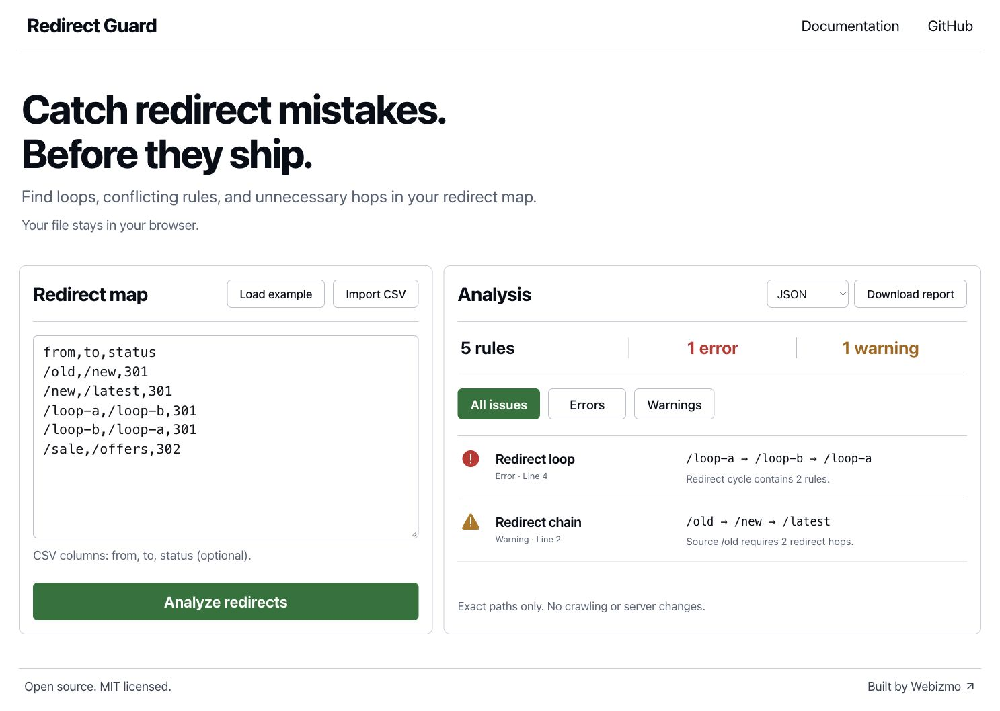

# Redirect Guard

Check a redirect CSV before a website migration. Find conflicting destinations, redirect loops, chains, and invalid rules in your browser or from the command line.

**[Open Redirect Guard](https://webizmo.github.io/redirect-guard/)** · [Try the example CSV](examples/redirects.csv) · [Report an issue](https://github.com/webizmo/redirect-guard/issues)

Redirect Guard is a small, dependency-free JavaScript application by [Webizmo](https://webizmo.tr/?utm_source=github&utm_medium=referral&utm_campaign=redirect_guard&utm_content=readme). The browser and CLI use the same analysis engine.



## Why use it?

A redirect spreadsheet can look correct while sending visitors through a chain or back to where they started. Redirect Guard checks the relationships between your rules before you configure them on a server.

- Detect duplicate sources and conflicting rules.
- Find self-redirects, cycles, and chains between local paths.
- Check source paths, target URLs, and redirect status codes.
- Export a report as JSON, Markdown, or CSV.
- Process your CSV locally in the browser, without uploading its contents.

## Browser

1. Open the [live application](https://webizmo.github.io/redirect-guard/).
2. Paste a CSV or choose a local CSV file.
3. Review the issues and export a report.

The application is served by GitHub Pages. Analysis runs in your browser; redirect destinations are not fetched. Opening the application still makes ordinary requests for its static files. Clicking external links opens those websites.

## CSV format

Use a header row with `from`, `to`, and `status` columns:

```csv
from,to,status
/old-about,/about,301
/old-contact,/contact,308
/external,https://example.com/new-page,302
```

Use quoted CSV fields when values contain commas. The [included example](examples/redirects.csv) deliberately contains problems so you can explore the reports.

Supported status codes are `301`, `302`, `303`, `307`, and `308`. If the `status` column is omitted or a status cell is blank, the rule defaults to `301`.

Headers must be exactly `from,to` or `from,to,status`, in that order. Values are not trimmed automatically.

### Matching and limits

- Input is limited to **5,000 rules** and **1 MiB of UTF-8 text**.
- Sources must be exact root-relative ASCII URL paths such as `/old-page`. Source queries, fragments, wildcards, and regular expressions are unsupported.
- Targets may be root-relative paths or absolute `http://` and `https://` URLs.
- Paths are case-sensitive, and trailing slashes are preserved: `/Blog`, `/blog`, and `/blog/` are different paths.
- Absolute URL targets and targets containing query strings or fragments are terminal destinations for graph analysis. Redirect Guard does not infer that an absolute URL belongs to your own site.
- Ambiguous paths are rejected, including whitespace, backslashes, repeated slashes, dot segments, template syntax, and malformed or normalization-sensitive percent encodings.
- Invalid rules and sources with conflicting definitions are excluded from graph traversal. Resolve those errors and run the check again: chains or cycles involving them may not appear until the rules are unambiguous.
- No network crawl is performed. The tool cannot confirm that a destination exists, that your server applies a rule, or that a migration preserves traffic or search rankings.
- The CSV is a review format, not an Apache, Nginx, CDN, or hosting-provider configuration. Review and translate it for your platform before deploying redirects.

## Command line

Requires Node.js 22 or newer. No dependency installation is required.

```sh
git clone https://github.com/webizmo/redirect-guard.git
cd redirect-guard
node bin/cli.js examples/redirects.csv --format json
node bin/cli.js examples/redirects.csv --format markdown
node bin/cli.js examples/redirects.csv --format csv
```

The example includes errors, so these example commands intentionally return a nonzero exit code.

| Exit code | Meaning |
| --- | --- |
| `0` | Analysis completed with no errors; warnings may still be present. |
| `1` | The analysis found errors. |
| `2` | The command could not run, for example because its arguments were invalid or its input file could not be read. |

To save a report:

```sh
node bin/cli.js redirects.csv --format markdown > redirect-report.md
```

## Run locally and contribute

```sh
npm test
npm start
```

Open the local URL printed by the server. To create the static deployment folder:

```sh
npm run build
```

GitHub Actions runs the test suite on Node.js 22 and 24. The Pages workflow tests and builds the application, then deploys `dist/` when changes reach `main`. See [CONTRIBUTING.md](CONTRIBUTING.md) for development guidance and [SECURITY.md](SECURITY.md) for security reporting.

## Made by Webizmo

Redirect Guard is maintained by [Webizmo](https://webizmo.tr/?utm_source=github&utm_medium=referral&utm_campaign=redirect_guard&utm_content=readme), a website design and development team. Planning a website redesign or migration? [Talk to Webizmo](https://webizmo.tr/?utm_source=github&utm_medium=referral&utm_campaign=redirect_guard&utm_content=readme).

## Türkçe

Redirect Guard, site taşıma veya yenileme öncesinde yönlendirme CSV dosyanızdaki çakışmaları, döngüleri, zincirleri ve geçersiz kuralları kontrol eder. [Tarayıcıda kullanın](https://webizmo.github.io/redirect-guard/); dosyanızın içeriği bir sunucuya yüklenmeden tarayıcınızda işlenir. Gerçek adresleri taramaz ve sunucu yapılandırmasını değiştirmez.

CSV başlıkları `from,to,status` olmalıdır. Araç en fazla 5.000 kural ve 1 MiB metin kabul eder. Site taşıma veya web tasarım desteği için [Webizmo'yu ziyaret edin](https://webizmo.tr/?utm_source=github&utm_medium=referral&utm_campaign=redirect_guard&utm_content=readme).

## License

[MIT](LICENSE) · Copyright 2026 Webizmo
